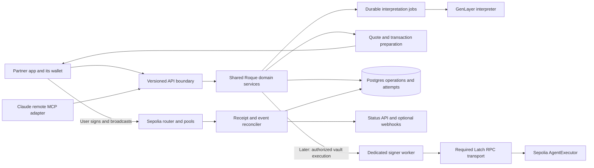

# Roque public swap API and agent connector implementation plan

Date: 2026-11-04. Baseline: `a0c34f6` on `master`, plus pre-existing local README and runner changes. This document proposes implementation; it does not claim that the API, connector, or security fixes already exist.

Implementation status (2026-11-04): public v1, asynchronous leased interpretation, immutable wallet-settled plans, provider-independent SDK, independent partner example, OAuth/MCP approval flow, first-party compatibility and security remediation are implemented. The existing Vercel web project hosts `/v1`, `/oauth`, `/mcp` and metadata through the shared Fastify adapter. Next `after()` drains one persisted job after relevant requests, authenticated cron/standalone workers provide recovery, and SQL leases fence overlapping invocations. See [usage and operations](PUBLIC_API.md), [security closure](SECURITY_REMEDIATION.md) and [release evidence](RELEASE.md). The optional delegated-payout design in section 8 remains behind its separate audit gate.

## 1. Product scope and recommendation

Make Roque's existing swap engine available to other applications and agent clients. A user should be able to type an intent inside a partner social app, review the actual trade, authorize it using that app's wallet, and receive the output in the same wallet. Claude should reach the same engine through a remote MCP server.

**Scope correction from the project owner:** the current Rialo integration is Latch. Settlement remains Ethereum Sepolia. Native Rialo contracts, a Rialo wallet integration, and bridging are outside this project. The API must accurately advertise Sepolia and the supported test tokens.

Recommended delivery order:

1. Fix the existing authorization, judgment-validation, and transaction-accounting issues; establish reproducible checks.
2. Deliver a versioned API for **wallet-signed, exact-input market swaps** into the user's connected app wallet.
3. Deliver a TypeScript SDK and a working partner-app example, backed by that API.
4. Add a remote MCP connector that prepares trades and opens a trusted wallet approval page. This does not require autonomous vault execution.
5. Add optional scoped autonomous execution after contract changes, migration, and a separate audit gate. Direct wallet payout from the autonomous vault requires an explicit new settlement design.

Keep event orders, playbooks, proposals, arbitrary recipients, native ETH wrapping, exact-output trades, new token listings, and cross-chain swaps outside public v1. Existing first-party features remain part of the security review because they share the signer, database, and contracts.

## 2. What the repository actually implements

| Area | Existing implementation | What can be reused / what is missing |
| --- | --- | --- |
| Execution market | [LiquidityPool](../contracts/src/LiquidityPool.sol), [DEXRouter](../contracts/src/DEXRouter.sol), ten test ERC-20s and 45 direct pools | Exact-input single-hop settlement, deadlines and output floors exist. This is not an external DEX aggregator or production token market. |
| User authorization | [AgentExecutor](../contracts/src/AgentExecutor.sol), EIP-712 types in [shared](../packages/shared/src/index.ts) | Vaults, capability caps, revocation, intent nonces and commitments exist. One capability per user; no partner identity, token-specific budgets, recipient policy, or capability generation in spend signatures. |
| Intelligence | [Python interpreter](../packages/genlayer/contracts/roque_interpreter.py), [GenLayer client](../packages/core/src/genlayer.ts) | Natural language, token aliases, interpretation and event judgments exist. Add strict schemas, request/result binding, stronger boolean validation and durable async jobs. |
| Domain services | [services.ts](../packages/core/src/services.ts), [intents.ts](../packages/core/src/intents.ts), [quote.ts](../packages/core/src/quote.ts) | Shared interpretation, quoting, preflight and signing already exist. Preparation currently returns arguments rather than a complete immutable transaction plan. |
| HTTP | [core handlers](../packages/core/src/api.ts), [Fastify](../apps/relayer/src/server.ts), [Next routes](../apps/web/src/app/api) | Both adapters call the same domain logic. Missing public versioning, client scopes, quotas, stable error codes, OpenAPI, public SDK and webhook delivery. Some route coverage/error behavior already differs. |
| Login | [auth.ts](../packages/core/src/auth.ts), [browser API](../apps/web/src/lib/api.ts) | One-time signed challenges, hashed one-hour bearer sessions and owner checks exist for autonomous actions. Sessions have no application, audience, scope or revocation boundary. |
| Wallet integration | [chain.ts](../apps/web/src/lib/chain.ts), [useWallet](../apps/web/src/lib/useWallet.ts), [Providers](../apps/web/src/providers/Providers.tsx) | Frontend signs with Privy-connected external wallets. This is not an embedded-wallet provisioning service. Extract a wallet-provider-independent SDK adapter. |
| Persistence | [Neon schema and queries](../packages/core/src/db/index.ts) | Intents, history, wallet sessions, event orders, playbooks, shares, proposals and reservation attribution exist. No durable execution-attempt journal or partner isolation. |
| Background work | [workers](../apps/relayer/src/workers.ts), [keeper](../packages/core/src/keeper.ts), [indexer](../packages/core/src/indexer.ts), Vercel/GitHub schedules | Conditional row claims exist. Sender queue is process-local; indexing can skip failed ranges; job recovery and confirmed settlement need work. |
| Latch | [relayer transport](../packages/core/src/chain.ts), [environment](../packages/core/src/env.ts), [.env.example](../.env.example) | Optional authenticated RPC transport for relayer writes. Actual agent and transaction signing use private keys in the Node process. Hosted policies/custody have not been verified. |

### Current settlement behavior matters

- Copilot: the user's wallet approves and calls the router. The router already accepts a recipient, and the frontend sets that recipient to the user. This directly supports an app's Sepolia wallet when that wallet can sign the transaction.
- Autonomous market swap: input is deducted from `vaultBalance[user]`; output goes to the executor and is credited to the user's vault. It is **not** paid directly into the app wallet. Withdrawal is owner-signed.
- Autonomous on-chain limit order: input leaves the vault for OrderBook escrow. Fill output and cancellation refunds go to the order owner's wallet. This differs from autonomous market swaps.
- Event orders and playbooks use vault market swaps. Their current confirmation and downstream-funding behavior needs remediation before external exposure.

The public contract and UI must say whether an outcome is a wallet balance or a vault credit. A transaction hash alone is not settlement evidence.

## 3. Architecture and trust boundaries



Reuse `@roque/core`; create an authenticated `RequestContext` containing verified client, subject/wallet, chain, audience, scopes and correlation ID. Never derive authorization from an arbitrary `user` field. Both HTTP adapters and MCP invoke the same services with this context.

Use the existing Fastify service as the public API host initially, with web routes remaining compatibility adapters. Refactor server creation away from listen/startWorkers side effects so HTTP contract tests can instantiate it. Run interpretation and signing workers independently; HTTP replicas must not each become a transaction sender. A Postgres jobs/outbox design is sufficient initially, using explicit transactions, leases, fencing and database-backed uniqueness. Add another queue product only when measured throughput requires it.

Retain the current Neon driver for suitable queries. Add transaction support where atomic multi-row changes are required; do not assume several HTTP queries share a transaction. Use versioned migration files and test them against an isolated database before release. No live database provisioning or migration was performed for this plan.

## 4. Identity, consent and permissions

There are three independent permissions:

1. **Application access:** a registered partner may use specified API operations within quotas. A server API key identifies the application; it never authorizes a user's money. Hash stored secrets, support rotation/revocation, record allowed origins and redirect URLs. Browser project IDs are public and are not credentials. For direct browser access, issue short-lived client-bound access through the partner backend or a supported public-client authorization flow.
2. **Wallet ownership and account linking:** authenticate the actual execution wallet. Scope sessions to application, chain, audience, permitted operations and expiry; provide per-connection disconnect and revocation. Use a standards-based EVM wallet login with expected domain/URI and a one-time nonce. [ERC-4361](https://eips.ethereum.org/EIPS/eip-4361) defines those checks. Never trust a social-platform login's wallet string without proof.
3. **Trade authority:** wallet-signed v1 requires approval of the exact transaction. Later unattended execution requires a separately signed on-chain capability. An OAuth scope, API key, MCP approval, or wallet-login signature does not create that capability.

Default v1 policy: execution account = authenticated wallet; recipient = execution account. Do not accept prompt-derived recipients. A changed amount, token, chain, recipient, deadline, or output floor invalidates the reviewed plan and requires review again. An immutable quote/plan hash pins that review.

Start the testnet SDK with explicitly supported EOA/provider wallets. Test at least one real partner embedded EVM wallet. Smart-account login and contract grants need deliberate support: the current server uses EOA message verification and Solidity grants use `ECDSA.recover`. If smart accounts are offered, implement and test chain-aware contract-signature verification and appropriate account execution. Avoid assuming a bundler transaction's outer `from` is the user's wallet.

## 5. Proposed public API v1

These are proposed routes, not existing endpoints. Publish OpenAPI plus generated request/response types and a compatibility policy. Use consistent request IDs and an error envelope such as `{ "error": { "code": "QUOTE_EXPIRED", "message": "...", "requestId": "..." } }`.

| Endpoint | Purpose | Authority |
| --- | --- | --- |
| `GET /v1/chains` | Supported chain/deployment versions and settlement capabilities | Public, rate-limited |
| `GET /v1/tokens?chainId=11155111` | Canonical addresses, decimals, supported operations and testnet labels | Public, rate-limited |
| `GET /v1/health` | Liveness; separate internal readiness/dependency checks | Minimal public response |
| `POST /v1/auth/challenges` | Issue client/chain-bound wallet challenge | Registered client; limited |
| `POST /v1/auth/sessions` | Verify proof and issue scoped session | Valid challenge and wallet proof |
| `DELETE /v1/auth/session` | Revoke this API connection | Authenticated subject |
| `POST /v1/intents` | Persist command and enqueue interpretation; return `202`, ID and status URL | Client plus wallet scope `intents:write` |
| `GET /v1/intents/{id}` | Interpretation/job state and normalized action | Same client and owner |
| `POST /v1/quotes` | Quote normalized exact-input action; store immutable quote ID | `quotes:read`; bounded computational cost |
| `POST /v1/swaps/prepare` | Bind quote to wallet and recipient; return transaction plan | `swaps:prepare`, same owner/client |
| `POST /v1/swaps/{id}/submissions` | Report a wallet-broadcast transaction for verification | Same owner/client; cannot assert success |
| `GET /v1/swaps/{id}` | Submission, receipt, confirmations and decoded settlement | Same owner/client |
| `POST /v1/swaps/{id}/approval-links` | Generate short-lived link to first-party approval UI for MCP/headless clients | `swaps:prepare`, same owner/client |

Future endpoints, disabled until the delegation release: `POST /v1/capabilities/prepare`, `GET /v1/capabilities/{id}`, `POST /v1/swaps/{id}/execute`. Prepare capability typed data for explicit wallet approval; do not let an app create authority from an unsigned JSON object. On-chain revoke remains available directly to the owner, independently of Roque availability.

Use HTTP `400/422` for shape/semantic errors, `401/403` for authentication/scope failures, `404` for inaccessible objects, `409` for conflicting idempotency/state, `410` for expired plans, `429` with `Retry-After`, and sanitized `5xx` for dependencies. Decide and document the exact stable mapping in the contract PR.

### Intent and transaction contract

Illustrative intent input:

```json
{
  "chainId": 11155111,
  "command": "Swap 10 rUSDC for rWETH",
  "executionMode": "wallet",
  "slippageBps": 100
}
```

Owner/client identity comes from authenticated context. In public v1, a conditional/limit interpretation is returned as unsupported, never silently converted into an immediate trade. Remove the current interpreter prompt instruction to turn non-rWETH limit requests into swaps, and test that conditional semantics survive interpretation. A percentage request must resolve to exact raw input units before review; public v1 can initially ask the user for an absolute amount.

Preparation returns `swapId`, `intentId`, `quoteId`, deployment version, chain ID, execution account, fixed recipient, token addresses/decimals, `amountInRaw`, `quotedAmountOutRaw`, `minAmountOutRaw`, fee and price-impact information, quote block number/hash, `expiresAt`, transaction deadline, `planHash`, and ordered transaction steps. Each step contains an allowlisted target, calldata, value, chain, function summary and expected effect.

Approval steps specify exact input allowance and the expected router spender. Native transaction `value` is zero for the current ERC-20 route. Do not freeze a wallet nonce while awaiting a human decision; the wallet adapter obtains current gas, nonce and fees immediately before sending. Re-simulate after approval; if the quote expires while approval mines, create and review a replacement plan.

The SDK must decode and validate the transaction against the plan and known deployment. It must never ask a wallet to sign arbitrary API-supplied calldata without those checks. Show token identity, exact spend, minimum receive, recipient, chain, price impact and gas before signing. No private keys, Latch tokens, agent signatures or seed phrases enter the SDK or MCP output.

### Durable lifecycle and retries

Keep interpretation, swap plan, execution attempt and webhook-delivery states separate:

```text
interpretation: queued -> interpreting -> ready | rejected | failed
plan:          prepared -> awaiting_wallet -> submitted -> confirming -> confirmed
               prepared/awaiting_wallet -> expired | cancelled
attempt:       created -> signed -> broadcast -> mined_success | mined_revert
               signed/broadcast -> submission_unknown | replaced | dropped
```

Persist `confirmed` only after a successful receipt and matching router/executor events for chain, deployment, account, recipient, pair and amount. Define the confirmation-depth/finality policy per supported deployment and surface `confirming` until it is met. Track block hashes and reverse/reconcile orphaned observations on reorg. An unknown submission remains under investigation; timeout is not proof that no funds moved.

Require `Idempotency-Key` for costly or stateful POSTs. Uniqueness is scoped to `(client, owner, chain, operation, key)`; store a canonical request hash and stable result. Identical repeats return the same operation; different payloads with the same key return `409`. Default retention proposal: at least 24 hours and beyond any in-flight attempt; document expiry. Plan expiry never deletes the transaction journal.

For relayed execution, persist the signed attempt and deterministic transaction hash before broadcast. Retrying means rebroadcasting that same transaction or an explicitly recorded same-nonce replacement, not generating a fresh business action. Keep intent nonces separate from gas-payer account nonces. A database lease with fencing plus one logical sender per `(chain, relayer)` coordinates all API replicas, crons and workers.

### Storage and operations

Add versioned migrations for `api_clients`, key hashes, `client_connections`, scoped sessions/consents, `swap_requests`, immutable `swap_quotes`, `swap_plans`, `execution_attempts`, `idempotency_records`, `jobs`, `outbox_events`, and optional `webhook_deliveries`. Retain links to the existing intent ID. Normalize wallet keys, add client/owner/chain indexes and bounded pagination, and keep all raw unit amounts as decimal strings or exact database numerics.

Quotas must cover interpretation calls, concurrent jobs, database/storage growth, public RPC traffic and sponsored gas separately. Rate-limit before GenLayer and signing; bound payloads, numeric lengths, timeout budgets and query limits. CORS is an integration policy, not authorization. Configure browser preflight explicitly; originless server clients still require credentials.

Polling is required for v1; webhooks can follow during the partner beta. Deliver from a transactional outbox, with stable event IDs, timestamps, HMAC signatures, replay windows, retries/backoff and dead-letter visibility. Validate registered HTTPS destinations and protect against private-network access, redirects and DNS rebinding. A webhook is a notification; status and chain evidence remain authoritative.

## 6. Latch integration work

Current evidence: `relayerWallet()` calls `privateKeyToAccount` locally and selects Latch only when both configuration values are nonempty. Intent EIP-712 signatures are also made locally. A configured Latch denial already propagates as an error; the configuration silently selects direct RPC when a value is missing. Browser wallet writes use the wallet/public RPC path.

For production relayer profiles:

- Add an explicit `LATCH_REQUIRED` policy. Missing/partial configuration fails readiness and refuses relayer writes. Keep an explicit local-development mode. Never fall back to direct RPC after a policy denial or outage.
- Verify the actual proxy endpoint and JSON-RPC compatibility. Restrict credentials, methods, traffic and gas budgets; confirm what policies can inspect in `eth_sendRawTransaction`. An opaque signed payload does not automatically give a JSON body filter token/recipient-level enforcement.
- Isolate the gas-payer wallet from the deployer/admin owner, redact RPC URLs and credentials, support token rotation, and correlate operation IDs with Latch activity where supported. Configure and verify activity retention; do not assume it is enabled.
- Keep user wallet approvals independent: using Latch for Roque's relayer does not mean every partner wallet transaction routes through it.
- Treat a future Latch-managed transaction signer as separate custody work. Its official [transaction-signing guide](https://onlatch.com/docs/guides/tx-signing-privy) describes a semantic transaction/signing flow; the current code uses an RPC transport. Verify EIP-712 signing support separately before moving the agent capability key. Update product claims to match the deployed custody mode.

Use [Latch simulation](https://onlatch.com/docs/guides/simulate) to verify allow/deny policy behavior without broadcasting. Test with a mock transport first, then a dedicated testnet setup. No hosted Latch policy or activity was accessed during this study.

## 7. Agent and Claude connector

Create `apps/mcp` as a thin authenticated adapter over the public API/service contract. Host a public HTTPS `/mcp` endpoint using Streamable HTTP. Claude custom connectors reach remote servers from Anthropic infrastructure; a localhost-only connector does not satisfy the web-chat use case. See [Claude custom connectors](https://support.claude.com/en/articles/11175166-get-started-with-custom-connectors-using-remote-mcp).

Use OAuth authorization-code consent with PKCE, protected-resource discovery, audience validation and narrow scopes. Choose a maintained authorization server, bind its subject to a verified wallet in a trusted first-party page, and support revocation. Select a pinned MCP SDK/spec version compatible with the Claude clients tested; implement the necessary client-registration compatibility. Follow the [MCP authorization specification](https://modelcontextprotocol.io/specification/latest/basic/authorization) and [Streamable HTTP transport](https://modelcontextprotocol.io/specification/latest/basic/transports). Do not repurpose the existing one-hour owner session as a universal connector credential or pass tokens to arbitrary upstreams.

| Tool | Behavior | Release |
| --- | --- | --- |
| `roque_list_tokens` | Return supported Sepolia assets and limitations | First MCP release |
| `roque_quote_swap` | Quote explicit pair/amount without spending | First MCP release |
| `roque_prepare_swap` | Create/retrieve an interpreted, reviewed swap plan | First MCP release |
| `roque_request_approval` | Return a trusted first-party approval URL | First MCP release |
| `roque_get_swap_status` | Read this connection's confirmed settlement | First MCP release |
| `roque_get_capability` | Read the connected wallet's delegation policy | Delegation release |
| `roque_execute_swap` | Execute only within an existing scoped on-chain capability | Delegation release |

Example experience: “Swap 10 rUSDC for rWETH.” Claude prepares a plan, returns an approval link, the user opens Roque's HTTPS page and signs with the linked app wallet, and Claude polls the swap ID for the actual result. Approval links are short-lived and owner-bound; possessing a URL does not authorize a trade. If linking that app's wallet is unavailable outside the partner app, provide a registered deep link back to its approval screen with the same plan binding, or explicitly require a supported wallet. Do not imply that Claude can open or control an arbitrary app wallet.

Tool metadata should describe read-only and spending operations accurately, but annotations and chat confirmations are not security controls. The server enforces scopes, ownership, plan validity and capabilities. Treat prompts, news evidence and tool output as untrusted data. No generic `send_transaction`, arbitrary calldata, grant/withdraw auto-approval, or model-supplied callback URLs.

## 8. Autonomous execution and direct wallet payout

Start by accurately exposing vault-credit behavior only after its audit gate. Offer direct app-wallet payout only after a new executor design is approved and tested. Recommended shape:

- A separate typed `executeSwapToOwner` action debits the existing vault and atomically transfers the swap output to the same authenticated owner's address. The signed intent binds settlement mode, recipient, deployment domain, capability ID/generation, quote minimum, amount, nonce and deadline.
- The capability explicitly permits this settlement mode and token pair. It does not allow an arbitrary relayer-selected recipient. A custom payout address requires separate owner-signed authorization and later scope.
- Do not credit a vault balance for tokens transferred to the wallet. Events must distinguish wallet payout from vault credit, and the indexer must reconcile both.
- Maintain existing vault-credit mode for strategies that reuse output. A social app can display either, but must label them differently.

Add contract-enforced per-connection capability identities or distinct agent signer identities, token/pair constraints, recipient rules, expiry, per-trade and daily limits, and revocation generations. The current single mapping cannot represent independent app/Claude budgets. An API-only `client_id` does not protect against a compromised shared signer. Document aggregate user limits across capabilities so connection count cannot silently multiply a user's risk budget.

Capabilities must be revocable independently by the owner. Every direct grant, signed grant, replacement and revoke invalidates the appropriate pending grant signatures and prior-generation spend signatures. Validate parameter ranges. Audit oracle freshness and economic output protection for swaps and limit orders. Generic AMM spot slippage is not a guarantee against manipulated quotes or a malicious signer.

The current executor is **not a proxy**. [UpgradeExecutor.s.sol](../contracts/script/UpgradeExecutor.s.sol) deploys a new contract; balances and capabilities do not migrate automatically. Include legacy vault discovery, owner withdrawal/redeposit guidance, lock release/revoke paths, outstanding-order behavior, refreshed ABI/domain/address registries, versioned indexer checkpoints and rollback handling. Preserve direct access to old funds. Do not deploy a new executor and hide the old address.

## 9. Work packages, dependencies and acceptance gates

Estimates below are engineering effort for someone familiar with this repo, not fixed calendar promises. They exclude external audit scheduling, service approval delays and new chain work.

| Package | Effort | Depends on | Reviewable output / acceptance |
| --- | --- | --- | --- |
| P0: baseline and threat model | 2–3 days | None | Reproducible Node/Foundry/Python checks, trust-boundary and endpoint inventory, issue register, failing regressions for confirmed findings. |
| P1: existing-stack remediation | 6–10 days | P0 | Strict judgment/result schemas, owner-scoped reporting/history, oracle and limit-slippage fixes, durable attempts, sender coordination and indexer recovery. Security regressions pass; legacy behavior documented. |
| P2: public API | 5–8 days | P1 gate for affected paths | Versioned schemas, client/owner authorization, quotas, async interpretation, immutable quote/plan, verified receipt/status, OpenAPI and adapter contract tests. |
| P3: SDK and partner example | 3–5 days | P2 schema | `packages/sdk`, provider adapter, integration guide, independent social-app demo; output reaches its connected Sepolia wallet. |
| P4: remote MCP with wallet approval | 4–7 days | P2; P3 wallet approval flow | OAuth wallet linking, five safe tools, approval page/deep link, Claude integration tests and disconnect behavior. |
| P5: scoped delegation and wallet payout | 8–15 days | P1, agreed policy and migration design | New executor/capability model, signatures, SDK, migration and independent security review; no spending on revoked/expired/wrong-connection grants. |
| P6: release review and pilot | 3–5 days + independent audit | Relevant packages | Remediation retest, staging load/failure tests, monitoring, incident runbook, allowlisted partner pilot and scoped rollout. |

Wallet-signed API + SDK + wallet-approved Claude connector: roughly **23–38 engineering days including P6**, with some overlap possible. Optional delegation adds about 8–15 days plus its audit/migration window. Release each gated deliverable when ready; do not make the first partner integration wait for autonomous payout.

Suggested PR sequence: baseline/security regressions; contract authorization/oracle fixes; private API and parser fixes; attempts/sender/indexer recovery; migrations and async jobs; public API/OpenAPI; SDK/demo; OAuth/approval UI; MCP; scoped executor/payout and migration; pilot/runbook. Contract redeployment belongs to a separately reviewed rollout after tests and audit findings are resolved.

### Tests that prove the intended product

1. **Independent app:** funded testnet app wallet authenticates, submits English, receives a normalized quote, signs exact allowance and swap, and receives the expected output balance. Verify receipts and decoded events, not just HTTP success. No production wallet needed.
2. **Tenant isolation:** app A cannot inspect, prepare, report, execute or poll app B's operations, even for the same wallet. Forged owners and altered recipients fail. API keys alone cannot spend.
3. **Review integrity:** changed fields, expired quotes, reused approvals, excessive price impact, unsupported tokens and conditional commands cannot become an unreviewed market trade.
4. **Recovery:** two replicas, duplicate POSTs, lost RPC replies, process crashes around every persistence/broadcast boundary, reverted/replaced/dropped transactions, and reorgs yield an accurate outcome without a fresh accidental trade.
5. **Judgment:** malformed booleans, missing fields, low confidence, invalid decimals and malicious prompt/evidence text fail closed. Use deterministic tests plus selected live GenLayer checks; the local shim is not a consensus test.
6. **Latch:** allow/deny, missing/partial configuration, revoked credential and outage tests prove required relayer operations stop. No direct-RPC bypass in the configured production sender path; user wallet flow is reported separately.
7. **Claude:** tool discovery, OAuth consent, wallet linking, quote, approve, settle, status, expiry and disconnect tested in a real custom connector. A revoked connection cannot prepare/execute new trades. On-chain authority and already-broadcast transactions are handled explicitly.
8. **Delegation:** Foundry unit/fuzz/invariant tests plus a real local chain exercise caps, stale oracle data, both action paths, capability generation, app isolation, vault solvency, locks, payout destination and migration exits.

Release gates: no unresolved critical/high finding on exposed execution paths; medium issues fixed or explicitly accepted with constraints; verified migration rollback and owner recovery; dependency/secret review; endpoint permission matrix enforced in both adapters; bounded interpretation/gas quotas; complete balance-change demonstration. A security review cannot promise the absence of every possible gap. Track findings to reproducer, fix, retest and independent review.

## 10. Defaults for implementation

- Public beta remains Sepolia with the ten registered test tokens; Latch is the Rialo-related integration.
- Wallet-signed swaps and same-wallet recipients ship first.
- Claude uses a remote MCP connector with wallet approval links first.
- Reuse core/Fastify/Neon and existing GenLayer interpretation; no new autonomous-agent framework is necessary.
- Partner signup may be manual for the beta; billing, a developer portal and webhook self-service follow demand.
- Scoped autonomous wallet payout is a later contract release, with migration and audit included in its scope.

The immediate implementation task is P0 followed by the highest-priority fixes in the [preliminary security review](SECURITY_REVIEW.md). No live trade, deployment, database migration or credential change is needed to start that work.
